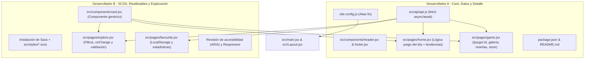
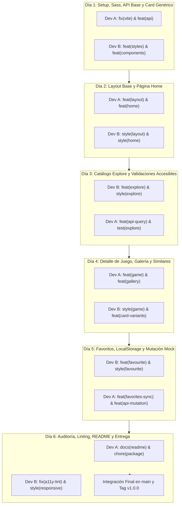

# Plan de Trabajo: Migración de Vanilla JS a React 19 + SCSS
**Proyecto:** FINDG — Segunda Entrega (Segundo Parcial de Desarrollo Web)  
**Equipo:** 2 Desarrolladores (Dev A y Dev B / Gregorio y Lucca)  
**Objetivo:** Transcribir fielmente y refactorizar la aplicación web interactiva desarrollada en Vanilla JS (Entrega 1) hacia una arquitectura moderna basada en componentes funcionales con React, React Router v7, Hooks, SCSS modular y consumo de API mockeada mediante `fetch` y `async/await`.

---

## 1. Estado Actual y Diagnóstico del Repositorio

### ✅ Lo que ya está completado:
- [x] **Estructura de carpetas:** Creada según los requerimientos (`src/components`, `src/pages`, `src/styles`, `src/data`, `src/api`).
- [x] **Base de Datos Mock:** [`src/data/db.json`](file:///C:/Users/miran/OneDrive/Escritorio/prog/Desarrollo-Web/proyecto2026-Carosanti-Miranda/segunda-entrega/src/data/db.json) validada en formato JSON estándar con los videojuegos iniciales.
- [x] **Componente Header:** [`src/components/header.jsx`](file:///C:/Users/miran/OneDrive/Escritorio/prog/Desarrollo-Web/proyecto2026-Carosanti-Miranda/segunda-entrega/src/components/header.jsx) implementado como función flecha, con logo desde `/public/favicon.ico` y enlaces activos con `NavLink`.
- [x] **Componente Footer:** [`src/components/footer.jsx`](file:///C:/Users/miran/OneDrive/Escritorio/prog/Desarrollo-Web/proyecto2026-Carosanti-Miranda/segunda-entrega/src/components/footer.jsx) implementado como función flecha con créditos y fuente de datos RAWG.
- [x] **Componente genérico Card:** [`src/components/card.jsx`](file:///C:/Users/miran/OneDrive/Escritorio/prog/Desarrollo-Web/proyecto2026-Carosanti-Miranda/segunda-entrega/src/components/card.jsx) implementado como función flecha, recibe `{ game }` directo de la API, sin JSDoc ni atributos sobrantes.
- [x] **Enrutamiento base y Layout:** [`src/Layout.jsx`](file:///C:/Users/miran/OneDrive/Escritorio/prog/Desarrollo-Web/proyecto2026-Carosanti-Miranda/segunda-entrega/src/Layout.jsx) con `<Header />`, `<Outlet />` y `<Footer />`, y [`src/main.jsx`](file:///C:/Users/miran/OneDrive/Escritorio/prog/Desarrollo-Web/proyecto2026-Carosanti-Miranda/segunda-entrega/src/main.jsx) con `BrowserRouter`.
- [x] **Capa de API:** [`src/api/api.js`](file:///C:/Users/miran/OneDrive/Escritorio/prog/Desarrollo-Web/proyecto2026-Carosanti-Miranda/segunda-entrega/src/api/api.js) implementada con `fetch` y `async/await` (`getGames`, `getGameById`, `getFavorites`, `addFavorite`, `removeFavorite`).

---

### ⏳ Lo que resta resolver/implementar (Pasos posteriores):
1. **Configuración de Vite:** En [`vite.config.js`](file:///C:/Users/miran/OneDrive/Escritorio/prog/Desarrollo-Web/proyecto2026-Carosanti-Miranda/segunda-entrega/vite.config.js), corregir los alias importando `fileURLToPath` y `URL` de `node:url` para resolver el error de ESM.
2. **SASS / SCSS:** Instalar `sass` (`npm i -D sass`) y migrar el archivo monolítico `style.css` a módulos `.scss` dentro de `src/styles/`.
3. **Páginas a implementar consumiendo la API:**
   - [`src/pages/home.jsx`](file:///C:/Users/miran/OneDrive/Escritorio/prog/Desarrollo-Web/proyecto2026-Carosanti-Miranda/segunda-entrega/src/pages/home.jsx): cálculo del juego del día y tendencias consumiendo `getGames()` mapeando `<Card />`.
   - [`src/pages/explore.jsx`](file:///C:/Users/miran/OneDrive/Escritorio/prog/Desarrollo-Web/proyecto2026-Carosanti-Miranda/segunda-entrega/src/pages/explore.jsx): catálogo con filtros reactivos (`onChange`), validaciones en tiempo real y accesibilidad.
   - [`src/pages/game.jsx`](file:///C:/Users/miran/OneDrive/Escritorio/prog/Desarrollo-Web/proyecto2026-Carosanti-Miranda/segunda-entrega/src/pages/game.jsx): detalle de juego mediante `useParams()`, galería interactiva de miniaturas y juegos similares.
   - [`src/pages/favourite.jsx`](file:///C:/Users/miran/OneDrive/Escritorio/prog/Desarrollo-Web/proyecto2026-Carosanti-Miranda/segunda-entrega/src/pages/favourite.jsx): persistencia de favoritos con `localStorage` y panel de estadísticas.

---

## 2. Matriz de Trazabilidad con los Requerimientos Oficiales

| Requisito Oficial | Responsable Asignado | Componente / Archivo Clave |
| :--- | :--- | :--- |
| **Vite + React 19** | Dev A | `package.json`, `vite.config.js` |
| **Imports con alias** | Ambos | `@components`, `@pages`, `@styles`, `@data`, `@api`, `@assets` |
| **react-router-dom + Outlet** | Dev A | `main.jsx`, `Layout.jsx`, navegación activa con `NavLink` |
| **Hooks (useState, useEffect, useNavigate, useParams)** | Ambos | Páginas (`home.jsx`, `game.jsx`, `explore.jsx`, `favourite.jsx`) |
| **Componente genérico reutilizable (Card / Button / Input)** | Dev B | `src/components/card.jsx` utilizado en Home, Explore, Game |
| **Validaciones en tiempo real (onChange + accesibilidad)** | Dev B | `src/pages/explore.jsx` (filtros con mensajes de error accesibles) |
| **Persistencia en localStorage** | Dev A & B | `localStorage` con clave `"favoritos"` (guardar/quitar IDs) |
| **Mock de servicio (db.json) + fetch async/await** | Dev A | [`src/api/api.js`](file:///C:/Users/miran/OneDrive/Escritorio/prog/Desarrollo-Web/proyecto2026-Carosanti-Miranda/segunda-entrega/src/api/api.js) (GET, POST y DELETE de juegos y favoritos) |
| **Imagen en /public y en assets** | Dev A & Dev B | Logo/Favicon en `/public` e íconos/fondos en `src/assets/` |
| **SASS: todos los estilos en .scss dentro de /styles** | Dev B | `src/styles/*.scss` importados con alias `@styles/...` |
| **Sin atributos no usados ni warnings de ESLint** | Ambos | Control de calidad con `npm run lint` |
| **Actualización de README.md y scripts de ejecución** | Dev A | `package.json` (`dev`, `build`, scripts de mock) y `README.md` |

> [!IMPORTANT]
> **Convención de Estilo y Documentación — Sin etiquetas `@param` / `@params`:**
> Por criterio del equipo y del docente, **NO se utilizan etiquetas JSDoc de `@param` ni `@params`** en los comentarios del código fuente. Todos los comentarios deben ser sencillos, directos y en lenguaje natural (ej: comentarios breves con `// ...` explicando la intención o bloque, sin sobrecargar con anotaciones de tipo JSDoc).

---

## 3. División de Roles y Responsabilidades (2 Personas)

Para evitar colisiones de Git y maximizar la independencia de trabajo:
- **Desarrollador A:** Enfocado en la **Lógica de Datos, Infraestructura, Enrutamiento Central y Páginas de Detalle (Home & Game)**.
- **Desarrollador B:** Enfocado en el **Diseño Modular SCSS, Componentes Reutilizables, Catálogo con Validaciones (Explore) y Favoritos (Favourite)**.



---

## 4. Cronograma de Trabajo Dividido por Commits Diarios

El cronograma está distribuido en **6 jornadas de trabajo (Días 1 al 6)**, asignando commits específicos, atómicos y bien delimitados para **Dev A (Gregorio)** y **Dev B (Lucca)** siguiendo la convención [Conventional Commits](https://www.conventionalcommits.org/).



---

### 📅 Día 1: Setup de Infraestructura, SCSS Base, Capa API y Componente Card

> **Meta del día:** Desbloquear el entorno de desarrollo, habilitar SCSS, levantar el mock server de datos y tener el primer componente reutilizable disponible para ambas ramas.

#### 👤 Dev A (Gregorio) — Infraestructura y Mock Server
- **Commit 1 (Dev A):**
  - **Mensaje:** `fix(vite): corregir resolucion de alias ESM y dependencias de node`
  - **Archivos:** [`vite.config.js`](file:///C:/Users/miran/OneDrive/Escritorio/prog/Desarrollo-Web/proyecto2026-Carosanti-Miranda/segunda-entrega/vite.config.js), [`package.json`](file:///C:/Users/miran/OneDrive/Escritorio/prog/Desarrollo-Web/proyecto2026-Carosanti-Miranda/segunda-entrega/package.json)
  - **Detalle:** Importar `fileURLToPath` y `URL` desde `node:url` para solucionar el `ReferenceError: path is not defined` en Vite. Verificar que `npm run dev` inicie sin errores.
- **Commit 2 (Dev A):** ✅ **[COMPLETADO]**
  - **Mensaje:** `feat(api): configurar json-server mock y servicio base con fetch y async/await`
  - **Archivos:** [`package.json`](file:///C:/Users/miran/OneDrive/Escritorio/prog/Desarrollo-Web/proyecto2026-Carosanti-Miranda/segunda-entrega/package.json), `src/api/api.js`, [`src/data/db.json`](file:///C:/Users/miran/OneDrive/Escritorio/prog/Desarrollo-Web/proyecto2026-Carosanti-Miranda/segunda-entrega/src/data/db.json)
  - **Detalle:** Agregar script `"server": "json-server --watch src/data/db.json --port 4000"`. Crear `src/api/api.js` con funciones asíncronas `getGames()` y `getGameById(id)` manejando errores con `try/catch`.

#### 👤 Dev B (Lucca) — Arquitectura SCSS y Componente Reutilizable
- **Commit 1 (Dev B):**
  - **Mensaje:** `feat(styles): instalar sass y estructurar parciales modulares base`
  - **Archivos:** [`package.json`](file:///C:/Users/miran/OneDrive/Escritorio/prog/Desarrollo-Web/proyecto2026-Carosanti-Miranda/segunda-entrega/package.json), `src/styles/_variables.scss`, `src/styles/_reset.scss`, `src/styles/main.scss`
  - **Detalle:** Instalar `sass` como devDependency (`npm i -D sass`). Configurar variables de colores neón, tipografías y reseteo básico importados en `main.scss`.
- **Commit 2 (Dev B):** ✅ **[COMPLETADO]**
  - **Mensaje:** `feat(components): implementar componente generico Card con children y soporte de props`
  - **Archivos:** [`src/components/card.jsx`](file:///C:/Users/miran/OneDrive/Escritorio/prog/Desarrollo-Web/proyecto2026-Carosanti-Miranda/segunda-entrega/src/components/card.jsx), `src/styles/_card.scss`, `src/styles/main.scss`
  - **Detalle:** Crear el componente funcional genérico `<Card />` que recibe `title`, `subtitle`, `image`, `badge`, `onClick` y `children` para máxima reutilización en Home, Explore y Game.

✅ **Checklist de Cierre del Día 1:**
- [ ] `npm run dev` y `npm run server` ejecutan en paralelo sin fallos.
- [x] La tarjeta genérica `<Card />` compila y admite children y contenido dinámico.
- [ ] `main.scss` compila limpiamente mediante Vite.

---

### 📅 Día 2: Layout Principal, Navegación Activa y Refactorización de Home

> **Meta del día:** Tener la navegación global operativa con `NavLink` y la pantalla de inicio (Home) consumiendo datos reales del mock con la lógica del "Juego del Día" y "Tendencias".

#### 👤 Dev A (Gregorio) — Header, Footer y Lógica de Home
- **Commit 1 (Dev A):** ✅ **[COMPLETADO]**
  - **Mensaje:** `feat(layout): implementar Header y Footer funcionales con NavLink y Outlet`
  - **Archivos:** [`src/components/header.jsx`](file:///C:/Users/miran/OneDrive/Escritorio/prog/Desarrollo-Web/proyecto2026-Carosanti-Miranda/segunda-entrega/src/components/header.jsx), [`src/components/footer.jsx`](file:///C:/Users/miran/OneDrive/Escritorio/prog/Desarrollo-Web/proyecto2026-Carosanti-Miranda/segunda-entrega/src/components/footer.jsx), [`src/Layout.jsx`](file:///C:/Users/miran/OneDrive/Escritorio/prog/Desarrollo-Web/proyecto2026-Carosanti-Miranda/segunda-entrega/src/Layout.jsx)
  - **Detalle:** Crear la barra de navegación con `<NavLink>` para aplicar automáticamente la clase `.active` en Inicio, Explorar y Favoritos. Usar logo desde `/public`.
- **Commit 2 (Dev A):**
  - **Mensaje:** `feat(home): conectar Home con API mock, calculo de juego del dia y tendencias dinamicas`
  - **Archivos:** [`src/pages/home.jsx`](file:///C:/Users/miran/OneDrive/Escritorio/prog/Desarrollo-Web/proyecto2026-Carosanti-Miranda/segunda-entrega/src/pages/home.jsx)
  - **Detalle:** Cargar juegos con `useEffect` llamando a `getGames()`. Calcular el juego del día en base al día del año e inyectarlo en el Hero. Ordenar por rating y mapear las tarjetas de tendencias usando `<Card />`.

#### 👤 Dev B (Lucca) — Estilos de Layout y Sección Home
- **Commit 1 (Dev B):**
  - **Mensaje:** `style(layout): disenar navegacion responsive, estados activos y footer en scss`
  - **Archivos:** `src/styles/_header.scss`, `src/styles/_footer.scss`, `src/styles/main.scss`
  - **Detalle:** Estilar cabecera con efecto backdrop-blur, indicador brillante para la ruta activa y pie de página responsivo con enlaces de autoría.
- **Commit 2 (Dev B):**
  - **Mensaje:** `style(home): maquetar hero dinámico, gradientes cyberpunk y grilla de tendencias`
  - **Archivos:** `src/styles/_home.scss`, `src/styles/main.scss`
  - **Detalle:** Crear animaciones suaves de entrada, estilos para el botón "Ver Detalles" del hero y la grilla responsive de categorías.

✅ **Checklist de Cierre del Día 2:**
- [ ] La navegación entre rutas cambia la URL y resalta la pestaña activa sin recargar el navegador.
- [ ] El juego del día se calcula matemáticamente de forma dinámica.
- [ ] La sección de tendencias renderiza componentes `<Card />` con datos de `db.json`.

---

### 📅 Día 3: Catálogo Explore, Filtros Reactivos y Validación Accesible

> **Meta del día:** Construir el catálogo interactivo en Explore, conectando los parámetros de búsqueda de la URL con filtros controlados (`onChange`), validaciones en tiempo real y alertas accesibles (`role="alert"`).

#### 👤 Dev B (Lucca) — Página Explore y Validaciones Accesibles
- **Commit 1 (Dev B):**
  - **Mensaje:** `feat(explore): implementar filtros reactivos onChange y lectura de query params`
  - **Archivos:** [`src/pages/explore.jsx`](file:///C:/Users/miran/OneDrive/Escritorio/prog/Desarrollo-Web/proyecto2026-Carosanti-Miranda/segunda-entrega/src/pages/explore.jsx)
  - **Detalle:** Leer categoría inicial vía `useSearchParams()`. Implementar formulario controlado con `useState` para: texto libre, select de categoría, slider de rating mínimo y año.
- **Commit 2 (Dev B):**
  - **Mensaje:** `feat(explore): agregar validaciones en tiempo real con mensajes accesibles aria-live`
  - **Archivos:** [`src/pages/explore.jsx`](file:///C:/Users/miran/OneDrive/Escritorio/prog/Desarrollo-Web/proyecto2026-Carosanti-Miranda/segunda-entrega/src/pages/explore.jsx), `src/styles/_explore.scss`
  - **Detalle:** Validar año de lanzamiento (1980 a 2026) y caracteres especiales en búsqueda. Renderizar mensajes con `role="alert"` y `aria-live="polite"`. Renderizar resultados filtrados con `<Card />` y botón de reset.

#### 👤 Dev A (Gregorio) — Soporte de Búsqueda en API y Navegación desde Categorías
- **Commit 1 (Dev A):**
  - **Mensaje:** `feat(api): anadir utilidades de filtrado y ordenamiento en gamesService`
  - **Archivos:** `src/api/api.js`
  - **Detalle:** Extender `gamesService.js` para admitir búsqueda por texto y categoría, permitiendo consultas locales y remotas eficientes.
- **Commit 2 (Dev A):**
  - **Mensaje:** `feat(home): vincular tarjetas de categorias con parametros de exploracion`
  - **Archivos:** [`src/pages/home.jsx`](file:///C:/Users/miran/OneDrive/Escritorio/prog/Desarrollo-Web/proyecto2026-Carosanti-Miranda/segunda-entrega/src/pages/home.jsx)
  - **Detalle:** Conectar los botones de categoría de la Home mediante `useNavigate` hacia `/explorar?categoria=Nombre` para garantizar la navegación cruzada fluida.

✅ **Checklist de Cierre del Día 3:**
- [ ] Hacer clic en una categoría del Home redirige a `/explorar` con el filtro preseleccionado.
- [ ] Los inputs reaccionan con `onChange` y validan el año o texto en tiempo real.
- [ ] Los errores tienen atributos de accesibilidad (`aria-live="polite"`).

---

### 📅 Día 4: Ficha de Juego Detallada, Galería Interactiva y Juegos Similares

> **Meta del día:** Desarrollar la vista dinámica `/juego/:id` con `useParams`, visor interactivo de galería con miniaturas deslizables, reseñas y sugerencias de títulos similares.

#### 👤 Dev A (Gregorio) — Vista Detalle con useParams y Galería
- **Commit 1 (Dev A):**
  - **Mensaje:** `feat(game): implementar ruta dinamica /juego/:id con useParams y carga de juego`
  - **Archivos:** [`src/main.jsx`](file:///C:/Users/miran/OneDrive/Escritorio/prog/Desarrollo-Web/proyecto2026-Carosanti-Miranda/segunda-entrega/src/main.jsx), [`src/pages/game.jsx`](file:///C:/Users/miran/OneDrive/Escritorio/prog/Desarrollo-Web/proyecto2026-Carosanti-Miranda/segunda-entrega/src/pages/game.jsx)
  - **Detalle:** Registrar ruta con parámetro `:id`. Obtener el detalle del videojuego con `getGameById(id)` y gestionar estado de carga y error si no se encuentra.
- **Commit 2 (Dev A):**
  - **Mensaje:** `feat(game): construir visor de galeria interactivo con selector de miniaturas y scroll`
  - **Archivos:** [`src/pages/game.jsx`](file:///C:/Users/miran/OneDrive/Escritorio/prog/Desarrollo-Web/proyecto2026-Carosanti-Miranda/segunda-entrega/src/pages/game.jsx)
  - **Detalle:** Estado `currentMedia` para imagen principal en alta resolución, carrusel de miniaturas con cambio al hacer clic y botones de scroll horizontal con `useRef`. Listar juegos similares usando `<Card />`.

#### 👤 Dev B (Lucca) — Estilos de la Ficha de Juego y Adaptabilidad
- **Commit 1 (Dev B):**
  - **Mensaje:** `style(game): maquetar banner dinamico, visor multimedia y carrusel de miniaturas`
  - **Archivos:** `src/styles/_game.scss`, `src/styles/main.scss`
  - **Detalle:** Estilar cabecera del juego con fondo difuminado dinámico, layout de dos columnas (galería + panel de compra y metadatos) y badges de géneros.
- **Commit 2 (Dev B):**
  - **Mensaje:** `style(game): disenar seccion de resenas, especificaciones tecnicas y lista de similares`
  - **Archivos:** `src/styles/_game.scss`
  - **Detalle:** Maquetar tarjetas de comentarios de usuarios, notas de rating y grilla inferior de juegos recomendados.

✅ **Checklist de Cierre del Día 4:**
- [ ] La URL `/juego/:id` carga el juego correspondiente y actualiza al cambiar el id.
- [ ] El visor de imágenes cambia la foto principal inmediatamente al presionar cualquier miniatura.
- [ ] La sección de juegos similares muestra títulos relacionados excluyendo el juego actual.

---

### 📅 Día 5: Favoritos, LocalStorage, Estadísticas y Mutación Mock

> **Meta del día:** Cumplir el requisito de persistencia con `localStorage`, botón toggle de favoritos reactivo, panel de estadísticas en `favourite.jsx` y agregar una mutación (POST/PATCH) en la API mock.

#### 👤 Dev B (Lucca) — Página Favoritos y Estadísticas
- **Commit 1 (Dev B):**
  - **Mensaje:** `feat(favourite): implementar pantalla de favoritos con persistencia en localStorage`
  - **Archivos:** [`src/pages/favourite.jsx`](file:///C:/Users/miran/OneDrive/Escritorio/prog/Desarrollo-Web/proyecto2026-Carosanti-Miranda/segunda-entrega/src/pages/favourite.jsx), `src/styles/_favourite.scss`
  - **Detalle:** Leer IDs desde `localStorage` (`"favoritos"`), filtrar juegos y renderizarlos. Permitir remover favoritos al presionar el corazón, actualizando vista y almacenamiento al instante.
- **Commit 2 (Dev B):**
  - **Mensaje:** `feat(favourite): anadir panel lateral de estadisticas y estado vacio descriptivo`
  - **Archivos:** [`src/pages/favourite.jsx`](file:///C:/Users/miran/OneDrive/Escritorio/prog/Desarrollo-Web/proyecto2026-Carosanti-Miranda/segunda-entrega/src/pages/favourite.jsx), `src/styles/_favourite.scss`
  - **Detalle:** Calcular dinámicamente total de juegos guardados, promedio de rating y género preferido. Mostrar mensaje amigable si la lista está vacía con enlace a explorar.

#### 👤 Dev A (Gregorio) — Toggle de Favorito en Ficha y Mutación Mock
- **Commit 1 (Dev A):**
  - **Mensaje:** `feat(game): integrar boton interactivo de favoritos con persistencia compartida`
  - **Archivos:** [`src/pages/game.jsx`](file:///C:/Users/miran/OneDrive/Escritorio/prog/Desarrollo-Web/proyecto2026-Carosanti-Miranda/segunda-entrega/src/pages/game.jsx), [`src/components/card.jsx`](file:///C:/Users/miran/OneDrive/Escritorio/prog/Desarrollo-Web/proyecto2026-Carosanti-Miranda/segunda-entrega/src/components/card.jsx)
  - **Detalle:** Añadir botón de favorito en la ficha del juego y opción en `<Card />` para marcar/desmarcar con reflejo instantáneo en el estado y en `localStorage`.
- **Commit 2 (Dev A):**
  - **Mensaje:** `feat(api): implementar mutacion POST/PATCH para agregar resenas a db.json`
  - **Archivos:** `src/api/api.js`, [`src/pages/game.jsx`](file:///C:/Users/miran/OneDrive/Escritorio/prog/Desarrollo-Web/proyecto2026-Carosanti-Miranda/segunda-entrega/src/pages/game.jsx)
  - **Detalle:** Implementar función `addReview(gameId, review)` usando `fetch` con método `PATCH`/`POST` para mutar el mock de `db.json`, cumpliendo con la exigencia de la rúbrica.

✅ **Checklist de Cierre del Día 5:**
- [ ] Los favoritos persisten luego de recargar el navegador (`localStorage`).
- [ ] El panel lateral de estadísticas calcula correctamente el rating promedio.
- [ ] Se ejecuta con éxito al menos una operación de mutación (POST/PATCH) contra `json-server`.

---

### 📅 Día 6: Auditoría de Rúbrica, ESLint, README y Preparación de Entrega

> **Meta del día:** Inspección de calidad total (0 warnings, 0 errores), validación de imágenes en `/public` y `assets`, imports con alias, documentación completa y freeze de entrega.

#### 👤 Dev B (Lucca) — Auditoría de Accesibilidad, Estilos y Responsive
- **Commit 1 (Dev B):**
  - **Mensaje:** `style(responsive): ajustar media queries para mobile y accesibilidad de contrastes`
  - **Archivos:** `src/styles/*.scss`
  - **Detalle:** Verificar layout en smartphones (360px a 768px), contrastes de color acordes a WCAG y navegación por teclado en inputs y botones.
- **Commit 2 (Dev B):**
  - **Mensaje:** `fix(lint): depurar imports no utilizados, props y warnings de accesibilidad`
  - **Archivos:** [`src/components/*.jsx`](file:///C:/Users/miran/OneDrive/Escritorio/prog/Desarrollo-Web/proyecto2026-Carosanti-Miranda/segunda-entrega/src/components), [`src/pages/*.jsx`](file:///C:/Users/miran/OneDrive/Escritorio/prog/Desarrollo-Web/proyecto2026-Carosanti-Miranda/segunda-entrega/src/pages)
  - **Detalle:** Ejecutar `npm run lint` y corregir cualquier advertencia de ESLint, eliminando variables y atributos huérfanos.

#### 👤 Dev A (Gregorio) — Auditoría de Recursos, Scripts y Documentación
- **Commit 1 (Dev A):**
  - **Mensaje:** `refactor(assets): verificar imagenes en public y assets e imports con alias`
  - **Archivos:** [`src/main.jsx`](file:///C:/Users/miran/OneDrive/Escritorio/prog/Desarrollo-Web/proyecto2026-Carosanti-Miranda/segunda-entrega/src/main.jsx), `src/components/*`, `src/pages/*`
  - **Detalle:** Asegurar que se use al menos una imagen desde `/public` y una importada desde `@assets`, y que todos los imports utilicen los alias `@components`, `@pages`, `@styles`, `@data`, `@api`, `@assets`.
- **Commit 2 (Dev A):**
  - **Mensaje:** `docs(readme): actualizar guia completa de instalacion, scripts y tecnologias`
  - **Archivos:** [`README.md`](file:///C:/Users/miran/OneDrive/Escritorio/prog/Desarrollo-Web/proyecto2026-Carosanti-Miranda/segunda-entrega/README.md), [`package.json`](file:///C:/Users/miran/OneDrive/Escritorio/prog/Desarrollo-Web/proyecto2026-Carosanti-Miranda/segunda-entrega/package.json)
  - **Detalle:** Redactar guía detallada paso a paso para clonar, instalar dependencias, levantar el servidor mock de json-server, correr Vite en desarrollo y generar el build de producción.

✅ **Checklist de Cierre del Día 6 (Listo para entrega):**
- [ ] `npm run lint` pasa con 0 errores y 0 warnings.
- [ ] `npm run build` genera la carpeta `dist/` sin ningún fallo.
- [ ] Merge limpio de ramas a `main`.

---

## 5. Tabla Resumen Consolidada de Commits Diarios

| Día | Dev | Tipo | Mensaje del Commit | Archivos Principales | Estado |
| :--- | :--- | :--- | :--- | :--- | :--- |
| **Día 1** | Dev A | `fix` | `fix(vite): corregir resolucion de alias ESM y dependencias de node` | `vite.config.js` | ⏳ Pendiente |
| **Día 1** | Dev A | `feat` | `feat(api): configurar json-server mock y servicio base con fetch y async/await` | `src/api/api.js`, `package.json` | ✅ **COMPLETADO** |
| **Día 1** | Dev B | `feat` | `feat(styles): instalar sass y estructurar parciales modulares base` | `src/styles/*.scss`, `package.json` | ⏳ Pendiente |
| **Día 1** | Dev B | `feat` | `feat(components): implementar componente generico Card con children y soporte de props` | `src/components/card.jsx` | ✅ **Completado** |
| **Día 2** | Dev A | `feat` | `feat(layout): implementar Header y Footer funcionales con NavLink y Outlet` | `src/components/header.jsx`, `Layout.jsx` | ✅ **Completado** |
| **Día 2** | Dev A | `feat` | `feat(home): conectar Home con API mock, calculo de juego del dia y tendencias dinamicas` | `src/pages/home.jsx` | ⏳ Pendiente |
| **Día 2** | Dev B | `style` | `style(layout): disenar navegacion responsive, estados activos y footer en scss` | `src/styles/_header.scss`, `_footer.scss` | ⏳ Pendiente |
| **Día 2** | Dev B | `style` | `style(home): maquetar hero dinámico, gradientes cyberpunk y grilla de tendencias` | `src/styles/_home.scss` | ⏳ Pendiente |
| **Día 3** | Dev B | `feat` | `feat(explore): implementar filtros reactivos onChange y lectura de query params` | `src/pages/explore.jsx` | ⏳ Pendiente |
| **Día 3** | Dev B | `feat` | `feat(explore): agregar validaciones en tiempo real con mensajes accesibles aria-live` | `src/pages/explore.jsx`, `_explore.scss` | ⏳ Pendiente |
| **Día 3** | Dev A | `feat` | `feat(api): anadir utilidades de filtrado y ordenamiento en gamesService` | `src/api/api.js` | ⏳ Pendiente |
| **Día 3** | Dev A | `feat` | `feat(home): vincular tarjetas de categorias con parametros de exploracion` | `src/pages/home.jsx` | ⏳ Pendiente |
| **Día 4** | Dev A | `feat` | `feat(game): implementar ruta dinamica /juego/:id con useParams y carga de juego` | `src/pages/game.jsx`, `src/main.jsx` | ⏳ Pendiente |
| **Día 4** | Dev A | `feat` | `feat(game): construir visor de galeria interactivo con selector de miniaturas y scroll` | `src/pages/game.jsx` | ⏳ Pendiente |
| **Día 4** | Dev B | `style` | `style(game): maquetar banner dinamico, visor multimedia y carrusel de miniaturas` | `src/styles/_game.scss` | ⏳ Pendiente |
| **Día 4** | Dev B | `style` | `style(game): disenar seccion de resenas, especificaciones tecnicas y lista de similares` | `src/styles/_game.scss` | ⏳ Pendiente |
| **Día 5** | Dev B | `feat` | `feat(favourite): implementar pantalla de favoritos con persistencia en localStorage` | `src/pages/favourite.jsx` | ⏳ Pendiente |
| **Día 5** | Dev B | `feat` | `feat(favourite): anadir panel lateral de estadisticas y estado vacio descriptivo` | `src/pages/favourite.jsx` | ⏳ Pendiente |
| **Día 5** | Dev A | `feat` | `feat(game): integrar boton interactivo de favoritos con persistencia compartida` | `src/pages/game.jsx`, `card.jsx` | ⏳ Pendiente |
| **Día 5** | Dev A | `feat` | `feat(api): implementar mutacion POST/PATCH para agregar resenas a db.json` | `src/api/api.js` | ⏳ Pendiente |
| **Día 6** | Dev B | `style` | `style(responsive): ajustar media queries para mobile y accesibilidad de contrastes` | `src/styles/*.scss` | ⏳ Pendiente |
| **Día 6** | Dev B | `fix` | `fix(lint): depurar imports no utilizados, props y warnings de accesibilidad` | `src/components/*`, `src/pages/*` | ⏳ Pendiente |
| **Día 6** | Dev A | `refactor` | `refactor(assets): verificar imagenes en public y assets e imports con alias` | `src/main.jsx`, `src/components/*` | ⏳ Pendiente |
| **Día 6** | Dev A | `docs` | `docs(readme): actualizar guia completa de instalacion, scripts y tecnologias` | `README.md`, `package.json` | ⏳ Pendiente |

---

## 6. Guía de Ejecución Técnica por Componente

### Fase 0: Setup Técnico y Corrección de Infraestructura (Dev A)
- **Tarea A0.1:** Modificar [`vite.config.js`](file:///C:/Users/miran/OneDrive/Escritorio/prog/Desarrollo-Web/proyecto2026-Carosanti-Miranda/segunda-entrega/vite.config.js) para resolver los alias sin errores:
  ```javascript
  import { fileURLToPath, URL } from "node:url";
  import react from "@vitejs/plugin-react";
  import { defineConfig } from "vite";

  export default defineConfig({
    plugins: [react()],
    resolve: {
      alias: {
        "@components": fileURLToPath(new URL("./src/components", import.meta.url)),
        "@pages": fileURLToPath(new URL("./src/pages", import.meta.url)),
        "@styles": fileURLToPath(new URL("./src/styles", import.meta.url)),
        "@data": fileURLToPath(new URL("./src/data", import.meta.url)),
        "@assets": fileURLToPath(new URL("./src/assets", import.meta.url)),
        "@api": fileURLToPath(new URL("./src/api", import.meta.url)),
      },
    },
  });
  ```
- **Tarea A0.2:** Probar que `npm run build` o `npx vite` levante correctamente.

---

### Fase 1: Arquitectura de Estilos SCSS y Capa de Servicios

#### Para Desarrollador B: Modularización SCSS
1. Instalar la dependencia de SASS en modo desarrollo:
   ```powershell
   npm install -D sass
   ```
2. Descomponer [`src/styles/style.css`](file:///C:/Users/miran/OneDrive/Escritorio/prog/Desarrollo-Web/proyecto2026-Carosanti-Miranda/segunda-entrega/src/styles/style.css) en una arquitectura limpia de parciales SCSS dentro de `src/styles/`:
   - `_variables.scss`: Paleta de colores (fondos oscuros, acentos cyan/azul), fuentes tipográficas, espaciados y breakpoints.
   - `_reset.scss`: Normalización y reseteo de box-sizing, márgenes y listas.
   - `_header.scss`: Barra de navegación con soporte para clase `.active` de `NavLink`.
   - `_footer.scss`: Pie de página y créditos.
   - `_card.scss`: Estilos de la tarjeta genérica (`.card-skeleton` y variantes hover).
   - `_home.scss`: Sección Hero, banner degradado y grilla de categorías.
   - `_game.scss`: Banner con variable CSS para el fondo dinámico, visor de galería grande, tira deslizante de miniaturas y reseñas.
   - `_explore.scss`: Formulario de búsqueda reactivo, slider de rating, campos accesibles y estados de error.
   - `_favourite.scss`: Lista de tarjetas favoritas, panel de resumen lateral y botón de corazón animado.
   - `main.scss`: Archivo maestro que importa todos los parciales mediante `@use` o `@forward`.
3. Reemplazar el import en componentes de `@styles/style.css` a `@styles/main.scss`.

#### Para Desarrollador A: Capa de Servicio API y Mock Server
1. **Configuración de `json-server` (siguiendo el estándar de la cátedra en Unidades 6 y 7):**
   - Instalar `json-server` como dependencia de desarrollo:
     ```powershell
     npm install -D json-server
     ```
   - Añadir script en `package.json`:
     ```json
     "server": "json-server --watch src/data/db.json --port 4000"
     ```
2. **Servicio API en `src/api/api.js`:**
   - Emplear el patrón de las clases prácticas (`Activities.jsx` y `Poke.jsx`):
     ```javascript
     const BASE_URL = "http://localhost:4000/";

     export const getGames = async () => {
       try {
         const response = await fetch(`${BASE_URL}juegos`);
         if (!response.ok) throw new Error("Error en la petición");
         return await response.json();
       } catch (error) {
         console.error("Error al obtener juegos:", error);
         return [];
       }
     };

     export const getGameById = async (id) => {
       try {
         const response = await fetch(`${BASE_URL}juegos/${id}`);
         if (!response.ok) throw new Error("Juego no encontrado");
         return await response.json();
       } catch (error) {
         console.error(`Error al obtener juego ${id}:`, error);
         return null;
       }
     };
     ```
   - Añadir al menos una acción de mutación (POST de review o PATCH) para cumplir el requerimiento de rúbrica.

#### Para Desarrollador B: Componente Genérico `Card.jsx`
1. **`src/components/card.jsx` (Patrón con `children` visto en clase):**
   - Siguiendo el ejercicio de la Unidad 6 (`Crad.jsx` / `Activities.jsx`), estructurar el componente genérico recibiendo `title`, `subtitle` (u opciones visuales) y `children`:
     ```jsx
     const Card = ({ title, subtitle, image, onClick, children }) => {
       return (
         <article className="card-skeleton" onClick={onClick}>
           {image && }
           {title && <span className="skeleton-title">{title}</span>}
           {subtitle && <span className="skeleton-rating">{subtitle}</span>}
           {children}
         </article>
       );
     };

     export default Card;
     ```
   - Este componente genérico se reutiliza en:
     1. `Home.jsx`: Tarjetas de Tendencias.
     2. `Explore.jsx`: Grilla de juegos filtrados.
     3. `Game.jsx`: Tira de juegos similares.

---

### Fase 3: Páginas Principales e Interactividad

#### Para Desarrollador A: `Home.jsx` y `Game.jsx`

##### 1. Refactorización de `src/pages/home.jsx`
- Usar `useState` y `useEffect` para cargar los juegos consumiendo `getGames()` de `@api/api.js`.
- **Cálculo del Juego del Día:**
  - Migrar la función matemática de `principal.js`:
    ```javascript
    const hoy = new Date();
    const inicioDeAno = new Date(hoy.getFullYear(), 0, 0);
    const diaDelAno = Math.floor((hoy - inicioDeAno) / (1000 * 60 * 60 * 24));
    const juegoDelDia = juegos[diaDelAno % juegos.length];
    ```
  - Inyectar el juego del día en el Hero con botón "Ver detalles" (`navigate(`/juego/${juegoDelDia.id}`)`).
- **Tendencias:**
  - Ordenar por rating descendente (`b.rating - a.rating`), tomar los primeros 5 y renderizarlos mapeando el componente `<Card />`.
- **Categorías:**
  - Convertir los enlaces `a href="explore.html?..."` a enlaces de React Router: `<Link to="/explorar?categoria=Acción">` o mediante `useNavigate`.

##### 2. Implementación de `src/pages/game.jsx`
- Configurar la ruta en `main.jsx` con parámetro dinámico: `<Route path="/juego/:id" element={<Game />} />`.
- Usar `useParams()` para capturar el `id`.
- En `useEffect`, obtener el juego mediante `getGameById(id)`.
- **Visor de Galería Interactivo:**
  - `const [currentImage, setCurrentImage] = useState(juego.media[0])`.
  - Visor principal que muestra `currentImage.url`.
  - Carrusel horizontal con miniaturas (`thumbs`). Al hacer clic en una miniatura, actualizar `currentImage`.
  - Botones de desplazamiento para desplazar el contenedor mediante `ref` (`element.scrollLeft += 200`).
- **Botón de Favoritos:**
  - Estado `isFavorite` verificado contra `localStorage.getItem("favoritos")`.
  - Alternar favorito guardando/eliminando el `id` en el arreglo persistido y cambiar el ícono entre `♡` y `♥`.
- **Juegos Similares:**
  - Filtrar juegos con el mismo género primario (`genre[0].name`), excluyendo el actual, renderizados con `<Card />`.

---

#### Para Desarrollador B: `Explore.jsx` y `Favourite.jsx`

##### 1. Implementación de `src/pages/explore.jsx`
- **Lectura de URL Query Params:**
  - Usar `useSearchParams()` de React Router para detectar si el usuario llegó desde una categoría del Home (`?categoria=RPG`).
- **Estado de Filtros (Controlados con `onChange`):**
  - `searchWord`: texto libre con validación en tiempo real.
  - `category`: select dropdown poblado dinámicamente o por categorías clave.
  - `minRating`: slider tipo range con indicador numérico reactivo.
  - `year`: input numérico con validación de rango (1980 a 2026).
- **Validaciones en tiempo real y accesibilidad (Requisito estricto):**
  - Implementar mensajes de error claros con `aria-live="polite"` y `role="alert"` si el año está fuera de rango o el término de búsqueda contiene caracteres inválidos.
  - Mostrar contador reactivo: `{filteredGames.length} juegos encontrados`.
- **Botón de Reinicio:** Limpia los estados a sus valores por defecto y restaura el catálogo completo.
- **Renderizado de Resultados:** Mapear los juegos resultantes empleando `<Card />`.

##### 2. Implementación de `src/pages/favourite.jsx`
- **Gestión de `localStorage`:**
  - Leer la lista de IDs guardados: `JSON.parse(localStorage.getItem("favoritos") || "[]")`.
  - Filtrar los juegos completos desde el servicio que coincidan con los IDs almacenados.
- **Panel de Resumen Lateral:**
  - Calcular dinámicamente cantidad de juegos guardados.
  - Calcular el rating promedio: `(sumaRating / cantidad).toFixed(1)`.
- **Lista de Favoritos:**
  - Renderizar cada tarjeta de favorito con datos de lanzamiento, desarrollador, descripción y etiquetas de género.
  - Botón interactivo de corazón (`♥`) para quitar de la lista inmediatamente, actualizando el estado local y el `localStorage`.
- **Estado Vacío (Empty State):**
  - Si no hay favoritos, mostrar mensaje descriptivo con enlace estilizado hacia `/explorar`.

---

### Fase 4: Integración, Rúbrica y Pruebas de Calidad (Ambos Devs)

1. **Rutas Finales en `src/main.jsx`**:
   ```jsx
   <Route path="/" element={<Layout />}>
     <Route index element={<Home />} />
     <Route path="explorar" element={<Explore />} />
     <Route path="favoritos" element={<Favourite />} />
     <Route path="juego/:id" element={<Game />} />
   </Route>
   ```
2. **Auditoría de Imágenes:**
   - Asegurarse de tener al menos una imagen servida desde `/public` (ej: `favicon.ico` o logo) y al menos una importada desde `src/assets/`.
3. **Control de Calidad de Código:**
   - Ejecutar `npm run lint` para garantizar que no existan variables sin uso, atributos innecesarios ni warnings de React Hooks.
4. **Actualización de Documentación (`README.md`):**
   - Incorporar instrucciones paso a paso para la instalación de dependencias (`npm install`), inicio del servidor de desarrollo (`npm run dev`) y build de producción (`npm run build`).

---

## 7. Estrategia de Ramas Git para Trabajar en Pareja

Para evitar colisiones en archivos compartidos:
- **Rama `main`:** Código de producción estable.
- **Rama `feature/dev-a-core-home-game`:** Para el trabajo de Dev A (Vite fix, API service, Header/Footer, Home, Game).
- **Rama `feature/dev-b-scss-explore-favs`:** Para el trabajo de Dev B (Sass, SCSS modules, Card genérico, Explore con validaciones, Favourite).
- **Puntos de sincronización:**
  1. Dev A publica la corrección de `vite.config.js` y el servicio API base.
  2. Dev B publica el componente `Card.jsx` y la configuración SCSS.
  3. Ambos integran sus páginas en `main.jsx` de forma coordinada.
